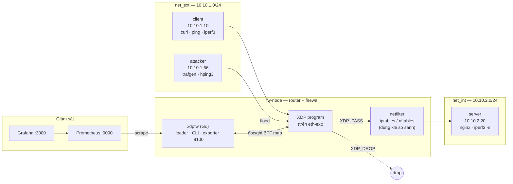
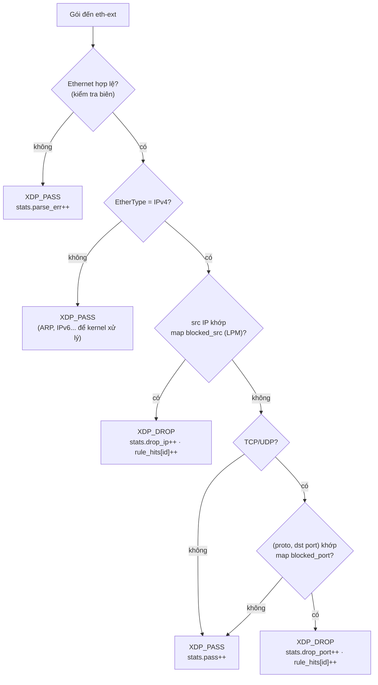
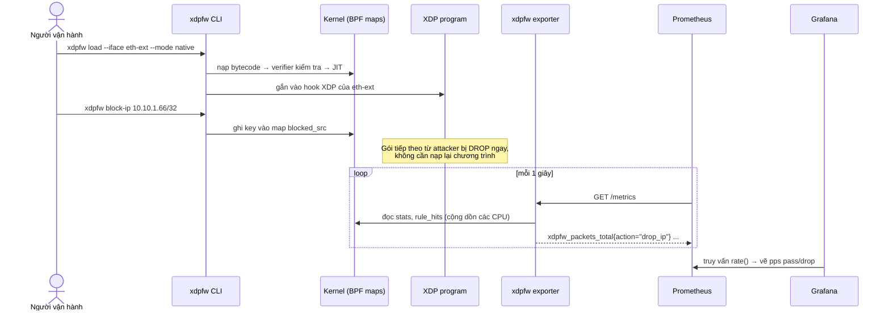
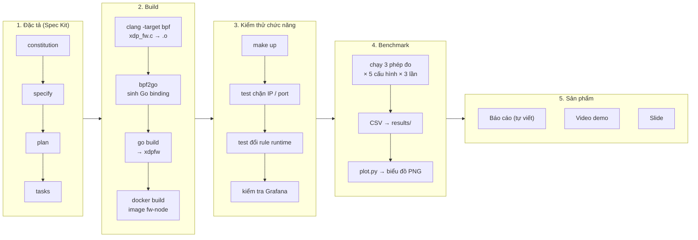

# Tổng quan Project — XDP Firewall chống DDoS & so sánh với iptables/nftables

> Môn: **Mạng thế hệ mới** — Project giữa kỳ, đề tài #2 *"P4 (BMv2) hoặc eBPF/XDP — Data plane lập trình được"*
> Thực hiện: 1 sinh viên + Claude (AI hỗ trợ) · Hạn nộp: **Thứ Sáu 27/11/2026** (code + báo cáo + video + slide)
> Tài liệu này là bản đồ kỹ thuật của project. Tiến độ chi tiết theo dõi ở [CHECKLIST.md](CHECKLIST.md).

---

## 1. Mục tiêu

| # | Mục tiêu | Kết quả đo được |
|---|---|---|
| 1 | Hiểu và trình bày kiến trúc eBPF/XDP — một **data plane lập trình được** chạy trong kernel Linux | Chương lý thuyết trong báo cáo, slide |
| 2 | Xây dựng **XDP Firewall**: chặn theo IP/subnet, port/giao thức, đếm gói — cập nhật rule lúc đang chạy | Chương trình chạy trong lab, CLI hoạt động |
| 3 | **So sánh hiệu năng** với giải pháp truyền thống (iptables, nftables) | Bảng số liệu + biểu đồ |
| 4 | Triển khai **lặp lại được** bằng docker-compose, lưu trên Git | `make up` chạy được từ repo sạch |
| 5 | Trình diễn kịch bản **chống tấn công flood** trực quan, có dashboard | Video demo ≤ 10 phút |
| 6 | Nêu rõ **hạn chế** của XDP và của môi trường thực nghiệm | Chương hạn chế |

### Phạm vi

- **Trong phạm vi:** IPv4; TCP/UDP/ICMP; chặn IP/CIDR nguồn; chặn port đích + giao thức; bộ đếm per-CPU; CLI; exporter Prometheus; dashboard Grafana; benchmark 3 phép đo.
- **Ngoài phạm vi (làm nếu dư thời gian):** rate limit theo IP (token bucket), load balancer L4, IPv6, lọc có trạng thái, benchmark trên VM với NIC ảo thật.

---

## 2. Kiến trúc tổng thể

### 2.1 Topology lab

Toàn bộ lab chạy trong **WSL2 Ubuntu 24.04 (kernel 6.18)** trên laptop, mỗi node là một container Docker. `fw-node` đóng vai trò router + firewall nằm giữa mạng ngoài và mạng trong.



**Ghim CPU** để giảm nhiễu khi đo (laptop i5-10300H, 8 luồng):

| Nhóm | CPU |
|---|---|
| client, attacker (sinh tải) | 0–3 |
| fw-node (thiết bị cần đo) | 4–7 |
| server, Prometheus, Grafana | dùng chung, không ảnh hưởng phép đo chính |

### 2.2 Các thành phần phần mềm

| Thành phần | Ngôn ngữ / công cụ | Vai trò |
|---|---|---|
| `bpf/xdp_fw.c` | C, biên dịch bằng clang → BPF bytecode, libbpf CO-RE | Chương trình data plane chạy tại hook XDP |
| `xdpfw` | Go + `cilium/ebpf` (bpf2go) | Nạp/gỡ chương trình, CLI quản lý rule, exporter Prometheus |
| `lab/` | docker-compose, Dockerfile | Dựng topology lab |
| `bench/` | Bash + Python (matplotlib) | Cấu hình iptables/nftables, sinh tải, thu & vẽ số liệu |
| Prometheus + Grafana | Docker image chính thức | Thu thập & hiển thị số liệu thời gian thực |

---

## 3. Luồng xử lý gói (data plane)

### 3.1 Vị trí của XDP trong kernel

```
 NIC / veth nhận gói
        │
        ▼
 ┌──────────────────┐   ◄── XDP native (xdpdrv): chạy trong driver, TRƯỚC khi cấp phát sk_buff
 │   Driver RX      │
 └──────────────────┘
        │  cấp phát sk_buff
        ▼
 ┌──────────────────┐   ◄── XDP generic (xdpgeneric): chạy SAU khi có sk_buff (chậm hơn native)
 │ netif_receive_skb│
 └──────────────────┘
        │
        ▼
 ┌──────────────────┐   ◄── TC ingress (tc-bpf)
 └──────────────────┘
        │
        ▼
 ┌──────────────────┐   ◄── netfilter: PREROUTING (bảng raw → conntrack → mangle → nat)
 │   IP stack       │   ◄── iptables "raw PREROUTING" là điểm sớm nhất của netfilter
 └──────────────────┘
        │ routing
        ▼
   INPUT / FORWARD (bảng filter) ...
```

**Ý tưởng cốt lõi để so sánh:** gói bị loại càng sớm thì càng tốn ít CPU. XDP native loại gói trước khi kernel cấp phát `sk_buff`, còn iptables chỉ thấy gói sau khi đã đi qua nhiều tầng.

### 3.2 Logic chương trình XDP



### 3.3 BPF maps (cầu nối kernel ↔ user space)

| Map | Kiểu | Key → Value | Độ phức tạp tra cứu | Dùng cho |
|---|---|---|---|---|
| `blocked_src` | `BPF_MAP_TYPE_LPM_TRIE` | `{prefixlen, ipv4}` → `rule_id` | O(độ dài prefix) ≈ hằng số | Chặn IP/subnet nguồn |
| `blocked_port` | `BPF_MAP_TYPE_HASH` | `{proto, dport}` → `rule_id` | O(1) trung bình | Chặn port + giao thức |
| `stats` | `BPF_MAP_TYPE_PERCPU_ARRAY` | `action` → `{pkts, bytes}` | O(1), không cần khóa | Đếm PASS / DROP_IP / DROP_PORT / PARSE_ERR |
| `rule_hits` | `BPF_MAP_TYPE_PERCPU_ARRAY` | `rule_id` → `{pkts, bytes}` | O(1) | Đếm số lần mỗi rule bị khớp |

> Map **per-CPU** cho phép mỗi CPU tự tăng bộ đếm của riêng nó mà không tranh chấp; user space cộng dồn khi đọc.

---

## 4. Luồng điều khiển (control plane)



### Các lệnh CLI dự kiến

| Lệnh | Chức năng |
|---|---|
| `xdpfw load --iface <if> --mode generic\|native` | Nạp và gắn chương trình XDP |
| `xdpfw unload --iface <if>` | Gỡ chương trình |
| `xdpfw block-ip <CIDR>` / `unblock-ip <CIDR>` | Thêm/xóa rule chặn IP/subnet |
| `xdpfw block-port <tcp\|udp> <port>` / `unblock-port ...` | Thêm/xóa rule chặn port |
| `xdpfw list` | Liệt kê rule hiện có |
| `xdpfw stats` | In bộ đếm pass/drop |
| `xdpfw serve --listen :9100` | Chạy exporter Prometheus |

---

## 5. Pipeline phát triển



### Các lệnh `make` dự kiến

| Lệnh | Việc làm |
|---|---|
| `make build` | Biên dịch BPF + Go, build image Docker |
| `make up` / `make down` | Dựng / dỡ toàn bộ lab |
| `make test` | Chạy kiểm thử chức năng (chặn đúng, không chặn nhầm) |
| `make demo` | Chạy kịch bản demo từng bước |
| `make bench` | Chạy toàn bộ benchmark, xuất CSV |
| `make plot` | Vẽ biểu đồ từ CSV |
| `make clean` | Xóa artifact build |

---

## 6. Phương pháp benchmark

### 6.1 Các cấu hình được so sánh

| Mã | Cấu hình | Vị trí chặn |
|---|---|---|
| `xdp-native` | XDP gắn chế độ driver trên veth | Driver RX, trước `sk_buff` |
| `xdp-generic` | XDP gắn chế độ generic | Sau khi có `sk_buff` |
| `ipt-raw` | `iptables -t raw -A PREROUTING ... -j DROP` | netfilter sớm nhất, trước conntrack |
| `ipt-filter` | `iptables -A FORWARD ... -j DROP` | Sau routing, có conntrack |
| `nft-set` | nftables dùng **set** (tra cứu hash) | netfilter, hook prerouting |
| `baseline` | Không có rule nào | Đối chứng |

> Thêm `nft-set` để so sánh **công bằng**: iptables chain tuyến tính là O(n), nhưng netfilter cũng có cấu trúc O(1) (nftables set / ipset). Như vậy báo cáo tách được hai yếu tố: *vị trí hook* và *cấu trúc dữ liệu tra cứu*.

### 6.2 Ba phép đo

| Phép đo | Thay đổi | Cố định | Đại lượng đo | Biểu đồ |
|---|---|---|---|---|
| **Đo 1 — Chi phí drop** | Cấu hình (bảng 6.1) | Tải flood cố định (vd. UDP 64B, tốc độ cố định) | % CPU softirq của fw-node (CPU 4–7), pps bị drop thực tế | Cột nhóm |
| **Đo 2 — Mở rộng theo số rule** | Số rule: 10 / 100 / 1.000 / 10.000 | Tải cố định; IP attacker nằm **cuối** danh sách (trường hợp xấu nhất) | % CPU, pps xử lý được | Đường, trục X dạng log |
| **Đo 3 — Ảnh hưởng tới traffic hợp lệ** | Có/không flood × cấu hình | Client chạy ping + iperf3 tới server | Độ trễ RTT (avg/p99), throughput iperf3 | Cột + error bar |

### 6.3 Quy tắc đo

- Mỗi điểm đo chạy **≥ 3 lần**, mỗi lần 30 giây, bỏ 5 giây đầu (khởi động); báo cáo trung bình ± độ lệch chuẩn.
- Đo ở **tải cố định** và so sánh **CPU tiêu thụ**: vì máy sinh tải và máy bị đo dùng chung một laptop, nên không đo "pps tối đa" mà đo "tốn bao nhiêu CPU cho cùng một lượng gói".
- Ghi lại: kernel, phiên bản công cụ, cấu hình `.wslconfig`, ghim CPU — đưa vào phụ lục báo cáo.
- Xóa sạch rule giữa các lần chạy (`iptables -F`, `nft flush ruleset`, `xdpfw unload`).

### 6.4 Công cụ

| Mục đích | Công cụ |
|---|---|
| Sinh flood UDP/SYN tốc độ cao | `trafgen` (netsniff-ng), `hping3` |
| Traffic hợp lệ | `ping`, `iperf3`, `curl` |
| Đo CPU | `mpstat -P 4-7 1` (cột `%soft`) |
| Đếm gói | Bộ đếm XDP map, `iptables -nvxL`, `nft list ruleset` |
| Vẽ biểu đồ | Python + pandas + matplotlib |

---

## 7. Kịch bản demo (video ≤ 10 phút)

| Bước | Thời lượng | Hành động | Người xem thấy gì |
|---|---|---|---|
| 0 | 1' | Giới thiệu topology, `make up` | 6 container chạy, Grafana trống |
| 1 | 1' | Client `curl` + `ping` server | Trang web trả về, RTT thấp |
| 2 | 1.5' | Attacker bắt đầu UDP/SYN flood | CPU fw-node tăng vọt, ping client trễ/mất gói |
| 3 | 2' | `xdpfw load` + `xdpfw block-ip 10.10.1.66/32` | Grafana: đường *drop* vọt lên, CPU giảm, client hồi phục |
| 4 | 1' | Chặn thêm port, `xdpfw stats`, `xdpfw list` | Rule đổi khi đang chạy, không gián đoạn |
| 5 | 2' | Gỡ XDP, chạy cùng kịch bản với iptables | CPU cao hơn rõ rệt cho cùng lượng tấn công |
| 6 | 1.5' | Trình bày biểu đồ benchmark + hạn chế | Kết luận |

---

## 8. Cấu trúc repo dự kiến

```
.
├── README.md                 # Hướng dẫn cài đặt & chạy
├── PROJECT_OVERVIEW.md       # Tài liệu này
├── CHECKLIST.md              # Tiến độ công việc
├── Makefile
├── bpf/
│   ├── xdp_fw.c              # Chương trình XDP
│   └── vmlinux.h             # Sinh từ BTF kernel (bpftool)
├── cmd/xdpfw/main.go         # Điểm vào CLI
├── internal/
│   ├── loader/               # Nạp/gắn/gỡ XDP
│   ├── rules/                # Thêm/xóa/liệt kê rule (ghi map)
│   └── exporter/             # Prometheus /metrics
├── lab/
│   ├── docker-compose.yml
│   ├── fw-node/Dockerfile
│   ├── node/Dockerfile       # Image chung cho client/attacker/server
│   ├── prometheus/prometheus.yml
│   └── grafana/provisioning/ # Datasource + dashboard JSON
├── bench/
│   ├── run_bench.sh          # Điều phối toàn bộ phép đo
│   ├── setup_iptables.sh
│   ├── setup_nftables.sh
│   ├── gen_rules.py          # Sinh N rule ngẫu nhiên
│   ├── flood.trafgen         # Cấu hình gói cho trafgen
│   └── plot.py
├── results/                  # CSV + PNG
├── docs/demo-script.md
└── specs/                    # Do Spec Kit sinh ra
```

---

## 9. Phân công

Project do **1 người** thực hiện, có Claude (AI) hỗ trợ — đúng quy định của đề: *"có thể sử dụng AI để trợ giúp trong toàn bộ quá trình, không sử dụng AI để gen báo cáo"*.

| Hạng mục | Claude (AI hỗ trợ) | Sinh viên |
|---|---|---|
| Code | Viết chương trình XDP, Go loader/CLI/exporter, docker-compose, Grafana | Review từng file, chạy thử, **tự giải thích được mọi dòng code** |
| Đo đạc | Viết script benchmark, chạy đo, vẽ biểu đồ | Kiểm tra số liệu hợp lý, tự diễn giải kết quả |
| Báo cáo | Chỉ giải thích kiến thức, trả lời câu hỏi | **Tự viết toàn bộ** (ch.1–6) |
| Trình bày | Đóng vai giảng viên hỏi phản biện | Slide, video demo, thuyết trình |

---

## 10. Lịch trình

| Ngày | Mục tiêu chính | Mốc hoàn thành |
|---|---|---|
| T2 23/11 | Môi trường + Spec Kit + dàn ý báo cáo | Smoke test XDP chạy được |
| T3 24/11 | Code firewall + lab + Grafana | Demo bước 1–4 chạy được |
| T4 25/11 | Benchmark | Có đủ CSV + biểu đồ |
| T5 26/11 | Demo, video, slide, hoàn thiện báo cáo | Video quay xong |
| T6 27/11 | Rà soát, nộp | Đã nộp |

---

## 11. Rủi ro & phương án dự phòng

| Rủi ro | Khả năng | Ảnh hưởng | Phương án |
|---|---|---|---|
| XDP native không gắn được trên veth trong container | Thấp | Mất 1 cấu hình so sánh | Dùng generic; ghi vào hạn chế |
| Docker trên host can thiệp gói (iptables của Docker, `br_netfilter`) | Trung bình | Số đo iptables bị nhiễu | Kiểm tra `br_netfilter`, đo baseline, ghi rõ trong báo cáo |
| Laptop không sinh đủ tải để thấy khác biệt | Trung bình | Biểu đồ không rõ | Đo theo CPU ở tải cố định; tăng số rule ở Đo 2 |
| Verifier từ chối chương trình | Trung bình | Chậm tiến độ code | Giữ chương trình đơn giản, kiểm tra biên đầy đủ, không vòng lặp |
| Thiếu thời gian viết báo cáo | **Cao** | 50% điểm | Viết song song từ Ngày 0, không dồn cuối tuần |
| RAM không đủ (Windows chỉ trống ~3 GB) | Thấp | Máy chậm khi quay video | Giới hạn WSL 8 GB, đóng ứng dụng khác khi đo/quay |

---

## 12. Hạn chế đã biết (đưa vào báo cáo)

1. **XDP chỉ xử lý chiều vào (ingress)**; chiều ra cần TC-BPF.
2. **Không có conntrack sẵn** — muốn lọc có trạng thái phải tự cài đặt bằng map.
3. **Verifier** giới hạn độ phức tạp, vòng lặp, kích thước stack (512 byte) → khó viết logic phức tạp.
4. **Phụ thuộc driver**: native mode cần driver NIC hỗ trợ; generic mode chậm hơn đáng kể.
5. **Gỡ lỗi khó** hơn iptables (cần `bpftool`, `bpf_printk`).
6. **Hạn chế môi trường thực nghiệm**: veth ảo trên WSL2, máy sinh tải và máy bị đo dùng chung CPU → số liệu mang tính **so sánh tương đối**, không phải hiệu năng đường truyền thật.

---

## 13. Sản phẩm nộp

| Sản phẩm | Yêu cầu | Nguồn |
|---|---|---|
| Báo cáo | ≤ 20 trang, **nhóm tự viết** | — |
| Repo Git | Có script cài lặp lại được, README đầy đủ | Repo này |
| Video demo | ≤ 10 phút | Kịch bản mục 7 |
| Slide | Trình bày 15 phút | — |
