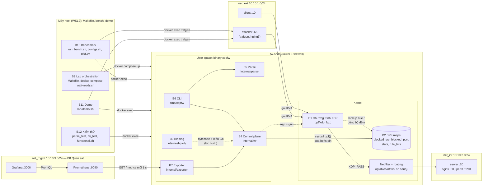
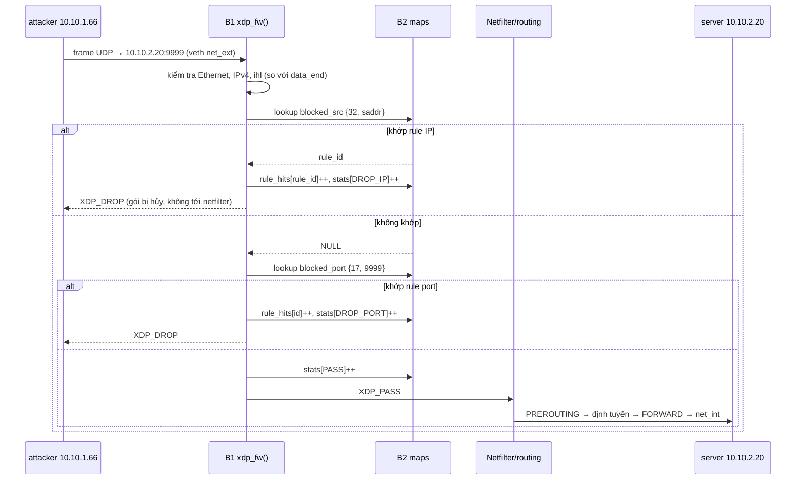
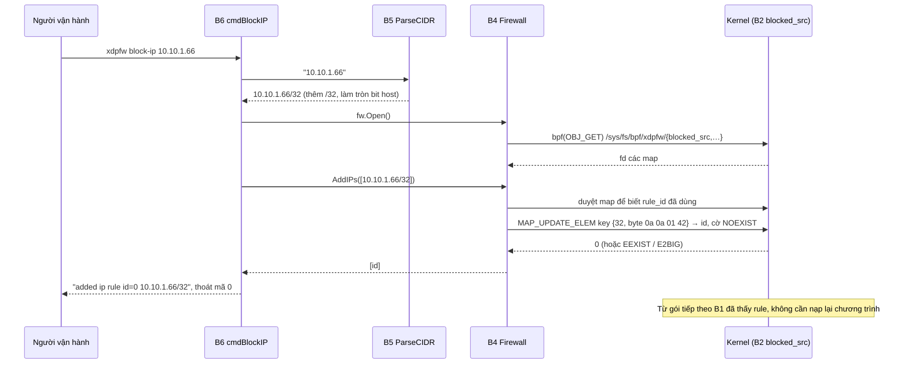
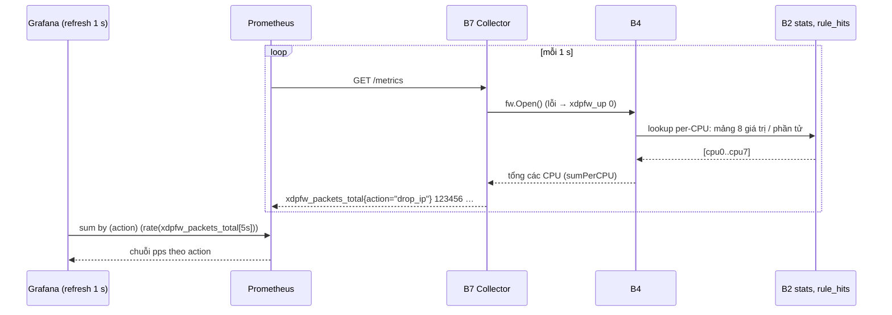

# Kiến trúc và hướng dẫn đọc code

Tài liệu đi từ tổng quan tới chi tiết:

1. [Tổng quan](#1-tổng-quan): project làm gì, gồm những phần lớn nào.
2. [Sơ đồ khối](#2-sơ-đồ-khối): 12 khối và đường nối giữa chúng.
3. [Giao tiếp giữa các khối](#3-giao-tiếp-giữa-các-khối): bảng request/response và 4 luồng chính.
4. [Chi tiết từng khối](#4-chi-tiết-từng-khối): nhiệm vụ, file, hàm chính, điểm cần hiểu.
5. [Luồng đọc code](#5-luồng-đọc-code): đọc file nào trước, lần theo luồng nào.

Trong code, đầu mỗi file có dòng `KHỐI Bx` trỏ về đúng mục của khối đó trong tài liệu này.

---

## 1. Tổng quan

Project có ba phần, xếp theo thứ tự phụ thuộc:

| Phần | Câu hỏi nó trả lời | Khối |
|---|---|---|
| **Firewall** | Chặn gói DDoS ngay ở driver như thế nào? | B1–B7 |
| **Lab** | Chạy và quan sát firewall ở đâu? | B8, B9 |
| **Đo đạc** | XDP rẻ hơn iptables/nftables bao nhiêu, và trong điều kiện nào? | B10–B12 |

Firewall chia làm hai nửa theo kiểu kinh điển của eBPF:

- **Data plane** (trong kernel): chương trình XDP chạy **cho từng gói**. Nó chỉ tra bảng rồi trả về
  `XDP_DROP` hoặc `XDP_PASS`. Nó không biết người dùng là ai và không có cấu hình nào khác ngoài các bảng.
- **Control plane** (user space): CLI `xdpfw` nạp chương trình, ghi rule vào bảng, đọc bộ đếm. Mỗi lệnh
  CLI là một tiến trình ngắn, chạy xong là thoát.

Hai nửa **không gọi hàm của nhau**. Chúng chỉ chia sẻ **BPF map** (bảng trong kernel): control plane ghi
rule vào, data plane đọc rule ra và ghi bộ đếm, control plane đọc bộ đếm lên. Đây là ý quan trọng nhất
để hiểu toàn bộ project.

---

## 2. Sơ đồ khối

### 2.1. Sơ đồ tổng thể



Nếu trình xem không vẽ được mermaid, dưới đây là bản ASCII rút gọn:

```
                 ┌──────────────────────────── fw-node ───────────────────────────────┐
 client ──┐      │  USER SPACE   B6 CLI ─▶ B5 parse                                     │
          │      │  (xdpfw)        │                                                   │
 attacker ┼─net_ext─▶ [B1 XDP]     ▼                                                   │
          │      │     │  ▲    B4 control plane ◀── B7 exporter ◀── GET /metrics ──┐    │
          │      │     │  │      │ syscall bpf() (map pin /sys/fs/bpf/xdpfw)       │    │
          │      │     │  └──── B2 BPF maps ◀─┘                                  │    │
          │      │   PASS▼                                                       │    │
          │      │  netfilter/routing ──net_int──▶ server                        │    │
          │      └─────────────────────────────────────────────────────────────────┼──┘
          │                                       net_mgmt: Prometheus ─┘ ◀── Grafana ◀── trình duyệt
          │
 host: B9 make up/down · B10 bench · B11 demo · B12 test  ──(docker exec)──▶ các container
```

### 2.2. Danh sách khối

| Khối | Tên | Chạy ở đâu | Nhiệm vụ một câu | File chính |
|---|---|---|---|---|
| **B1** | Chương trình XDP | Kernel fw-node, mỗi gói | Parse gói, tra rule, trả DROP/PASS, đếm | `bpf/xdp_fw.c` |
| **B2** | BPF maps | Bộ nhớ kernel | Nơi duy nhất data plane và control plane chia sẻ dữ liệu | khai báo trong `bpf/xdp_fw.c` |
| **B3** | Build & binding | Lúc build (Docker stage `builder`) | Biên dịch C → bytecode, sinh kiểu Go khớp struct C | `internal/bpfobj/gen.go`, `lab/fw-node/Dockerfile` |
| **B4** | Control plane | User space fw-node | Nạp/gỡ chương trình, pin map, thêm/xóa rule, đọc bộ đếm | `internal/fw/loader.go`, `rules.go`, `stats.go` |
| **B5** | Parse đầu vào | User space | Kiểm tra và chuẩn hóa CIDR, giao thức, port | `internal/parse/parse.go` |
| **B6** | CLI | User space | Nhận lệnh, gọi B5 + B4, in kết quả, trả mã thoát | `cmd/xdpfw/main.go` |
| **B7** | Exporter | Tiến trình `xdpfw serve` | Mỗi lần được scrape: đọc map, trả metric Prometheus | `internal/exporter/exporter.go` |
| **B8** | Quan sát | Container prometheus, grafana | Thu metric mỗi 1 s, vẽ dashboard | `lab/prometheus/`, `lab/grafana/` |
| **B9** | Lab orchestration | Host + Docker | Dựng 6 container, 3 mạng, định tuyến, chờ sẵn sàng | `Makefile`, `lab/docker-compose.yml`, `lab/*/entrypoint.sh`, `lab/wait-ready.sh` |
| **B10** | Benchmark | Host | Bật 8 cấu hình lọc, bắn flood, đo, ghi CSV, vẽ | `bench/*` |
| **B11** | Demo | Host | Các lệnh tắt cho kịch bản demo 10 phút | `lab/demo.sh` |
| **B12** | Kiểm thử | Host / builder | Kiểm chứng parse, chương trình XDP, hệ thống chạy thật | `internal/parse/parse_test.go`, `internal/fw/fw_test.go`, `tests/functional.sh` |

---

## 3. Giao tiếp giữa các khối

### 3.1. Bảng request/response

| # | Bên gọi → bên nhận | Kênh | Request | Response |
|---|---|---|---|---|
| 1 | Driver/veth → **B1** | Hook XDP (kernel gọi hàm `xdp_fw`) | `struct xdp_md *ctx`: con trỏ `data`, `data_end` của gói | Số nguyên: `XDP_DROP` (1) hoặc `XDP_PASS` (2) |
| 2 | **B1** → **B2** | Helper `bpf_map_lookup_elem` | Key `{prefixlen=32, addr=saddr}` hoặc `{proto, dport}` | Con trỏ tới `rule_id`, hoặc `NULL` nếu không khớp |
| 3 | **B1** → **B2** | Ghi trực tiếp qua con trỏ | `count()`: `packets++`, `bytes += len` trên bản per-CPU | (không có) |
| 4 | **B6** → **B5** | Gọi hàm Go | Chuỗi người dùng gõ: `"10.10.1.66"`, `"udp"`, `"9999"` | `netip.Prefix` / `uint8` / `uint16` đã chuẩn hóa, hoặc lỗi → mã thoát 2 |
| 5 | **B6** → **B4** | Gọi hàm Go | `fw.Load`, `Open`, `AddIPs`, `DelIP`, `AddPort`, `List`, `ReadStats`, `Flush` | Dữ liệu, hoặc lỗi định danh (`ErrExists`, `ErrFull`, …) → `exitCode()` |
| 6 | **B4** → kernel | Syscall `bpf(BPF_PROG_LOAD)` | Bytecode từ B3 | fd chương trình, hoặc lỗi verifier |
| 7 | **B4** → kernel | Syscall `bpf(BPF_LINK_CREATE)` | fd chương trình + ifindex + cờ native/generic | fd link, hoặc `EBUSY`/`EEXIST` nếu interface đã có XDP → `ErrConflict` |
| 8 | **B4** → **B2** | Syscall `bpf(BPF_MAP_UPDATE_ELEM / DELETE / LOOKUP / GET_NEXT_KEY)` trên map mở từ pin `/sys/fs/bpf/xdpfw/*` | key + value + cờ `BPF_NOEXIST` | 0, `EEXIST` (rule trùng), `E2BIG` (bảng đầy), `ENOENT` |
| 9 | **B4** ↔ đĩa | File `/run/xdpfw/meta.json` | `load` ghi iface/mode/prog_id/thời điểm | `status` và exporter đọc lại |
| 10 | **B8** Prometheus → **B7** | HTTP `GET http://10.10.9.254:9100/metrics`, mỗi 1 s | (không tham số) | Văn bản Prometheus: `xdpfw_up`, `xdpfw_packets_total{action}`, `xdpfw_rule_packets_total{id,type,match}`, … |
| 11 | **B8** Grafana → Prometheus | HTTP PromQL (`/api/v1/query_range`) | `sum by (action) (rate(xdpfw_packets_total[5s]))`, `topk(10, …)` | JSON chuỗi thời gian |
| 12 | Trình duyệt → Grafana | HTTP `localhost:3000` | Mở dashboard "XDP Firewall", tự làm mới mỗi 1 s | Trang dashboard |
| 13 | **B9/B10/B11/B12** → container | `docker exec` | Lệnh shell: `xdpfw …`, `iptables-restore`, `nft -f -`, `trafgen`, `ping`, `iperf3` | stdout + mã thoát |
| 14 | **B10** → kernel host | `mpstat`, `bpftool prog show -j`, `/sys/class/net/*/statistics` | Lấy mẫu trước/sau mỗi lần đo | %CPU, `run_time_ns`/`run_cnt`, `rx_packets` |

Chú ý hai điểm:

- B1 **không bao giờ gọi** B4 và ngược lại. Mọi trao đổi giữa hai bên đi qua B2 (dòng 2, 3, 8).
- B7 **không giữ trạng thái**. Mỗi lần Prometheus hỏi, nó mở map, đọc rồi đóng (dòng 10 → 5 → 8).

### 3.2. Luồng A: một gói đi qua fw-node (data plane)



### 3.3. Luồng B: `xdpfw block-ip 10.10.1.66` (control plane ghi rule)



### 3.4. Luồng C: `xdpfw load` (nạp và giữ firewall sống sau khi CLI thoát)

1. B6 `cmdLoad` kiểm tra `--iface`, `--mode`.
2. B4 `fw.Load`:
   - nếu đã có `/sys/fs/bpf/xdpfw` thì báo `ErrAlreadyLoaded`;
   - mount bpffs nếu chưa có;
   - `bpfobj.LoadXdpFwObjects` gửi bytecode (sinh từ B3) vào kernel, verifier kiểm tra, JIT biên dịch;
   - `link.AttachXDP` gắn chương trình vào interface. Nếu interface đã có XDP thì kernel từ chối, không ghi đè ngầm;
   - **pin** 4 map và link vào `/sys/fs/bpf/xdpfw/`. Đây là bước giữ firewall sống: khi tiến trình
     thoát, fd bị đóng nhưng kernel vẫn còn tham chiếu qua file pin;
   - ghi `/run/xdpfw/meta.json`.
3. `unload` làm ngược lại: unpin link. Khi không còn tham chiếu nào, kernel tự gỡ XDP khỏi interface.

### 3.5. Luồng D: từ bộ đếm trong kernel tới đồ thị Grafana



Bộ đếm trong kernel là **counter tăng dần**. Prometheus lưu giá trị thô, còn Grafana dùng `rate()` để
đổi thành gói/giây.

---

## 4. Chi tiết từng khối

### B1. Chương trình XDP — `bpf/xdp_fw.c`

**Nhiệm vụ:** quyết định số phận từng gói tại hook XDP, tức là ngay sau driver và trước khi stack mạng xử lý gói.

| Bước | Code | Ý nghĩa |
|---|---|---|
| 1 | `eth + 1 > data_end` | Mọi lần đọc gói phải chứng minh cho verifier là không vượt `data_end` |
| 2 | `h_proto != ETH_P_IP` → PASS | ARP, IPv6 nằm ngoài phạm vi. Nguyên tắc: **không hiểu thì cho qua** |
| 3 | `ihl < 5` hoặc header cụt → `PARSE_ERR` + PASS | Gói hỏng vẫn cho qua để kernel tự xử lý, chỉ đếm lại |
| 4 | lookup `blocked_src` (LPM) | Kiểm tra **trước** giao thức: IP bị chặn thì mọi gói của nó (ICMP, fragment) đều bị chặn |
| 5 | không phải TCP/UDP → PASS; fragment thứ 2 trở đi → PASS | Các gói này không có port để so |
| 6 | lookup `blocked_port` (hash) | Key `{proto, pad=0, dport}`, giữ network byte order |
| 7 | `verdict()` | Cộng `stats[...]` rồi trả action |

**Điểm cần hiểu:**

- `__always_inline`: hàm phụ được nhúng thẳng vào chương trình, nên verifier dễ chứng minh tính an toàn.
- Kiểm tra `if (c)` sau `bpf_map_lookup_elem` là bắt buộc dù `idx` luôn hợp lệ. Thiếu nó, verifier từ chối chương trình.
- Không dùng `vmlinux.h`/CO-RE vì chương trình chỉ đọc header gói (định dạng cố định theo RFC), không đọc struct nội bộ của kernel (constitution 1.0.1).

### B2. BPF maps — "giao diện" giữa kernel và user space

| Map | Kiểu | Key → Value | Ai ghi | Ai đọc |
|---|---|---|---|---|
| `blocked_src` | `LPM_TRIE`, 16384 phần tử | `{prefixlen, addr}` → `rule_id` | B4 | B1 (mỗi gói), B4 (`list`) |
| `blocked_port` | `HASH`, 1024 phần tử | `{proto, pad, dport}` → `rule_id` | B4 | B1, B4 |
| `stats` | `PERCPU_ARRAY`, 4 phần tử | `pass/drop_ip/drop_port/parse_err` → `{packets, bytes}` | B1 | B4, B7 |
| `rule_hits` | `PERCPU_ARRAY`, 17408 phần tử | `rule_id` → `{packets, bytes}` | B1 (B4 đặt về 0 khi xóa rule) | B4, B7 |

- **LPM trie** trả về prefix dài nhất khớp, nên một map dùng được cho cả IP lẻ (/32) lẫn subnet (/24).
  Chi phí tăng theo độ sâu cây: khoảng 70 → 150 ns/gói khi số rule tăng từ 10 lên 10 000 (Đo 2).
- **Per-CPU**: mỗi CPU có bản riêng, nên cộng không cần khóa và không tranh chấp cache line. Bù lại, user
  space phải tự cộng các bản (`sumPerCPU`).
- **Dải `rule_id`**: IP dùng `[0, 16384)`, port dùng `[16384, 17408)`. Cả hai chung một mảng `rule_hits`.
  Hằng số trong C (`MAX_IP_RULES`) và Go (`ipIDMax`) **phải khớp nhau**.

### B3. Build & binding — `internal/bpfobj/gen.go`, `lab/fw-node/Dockerfile`

- `go generate` gọi **bpf2go**: `clang -O2 -target bpfel` biên dịch `xdp_fw.c` thành `xdpfw_bpfel.o`,
  rồi sinh `xdpfw_bpfel.go` gồm:
  - `XdpFwObjects` (chương trình + 4 map);
  - `LoadXdpFwObjects()`;
  - các struct Go khớp byte với struct C: `XdpFwLpmV4Key`, `XdpFwPortKey`, `XdpFwCounter`.
- File `.o` được **nhúng vào binary Go**, nên container chạy chỉ cần một file `xdpfw`, không cần clang.
- Dockerfile có 2 stage: `builder` (Go + clang + libbpf-dev) và `runtime` (Debian slim + iproute2,
  iptables, nftables, bpftool).

### B4. Control plane — `internal/fw/`

| File | Nhiệm vụ | Hàm chính |
|---|---|---|
| `loader.go` | Vòng đời chương trình: nạp, gắn, pin, gỡ; mở lại map đã pin | `Load`, `Unload`, `Open`, `Close`, `ensureBpffs` |
| `rules.go` | Đọc/ghi rule; chuyển key Go ↔ byte của map; cấp `rule_id` | `AddIPs`, `DelIP`, `AddPort`, `DelPort`, `List`, `Flush`, `ipKey`, `portKey`, `allocator` |
| `stats.go` | Đọc/xóa bộ đếm per-CPU | `ReadStats`, `sumPerCPU`, `zeroPerCPU` |

**Điểm cần hiểu:**

- **Pin trong bpffs** là cơ chế giúp một CLI "chạy xong rồi thoát" vẫn điều khiển được firewall đang chạy (mục 3.4).
- **Byte order**: gói chứa IP/port theo big-endian, và B1 dùng thẳng giá trị đó làm key. Vì vậy B4 phải
  dựng key sao cho **byte trong bộ nhớ** giống hệt byte trong gói. `binary.NativeEndian.Uint32(ip[:])`
  làm đúng việc này.
- `DelIP` phải **duyệt** map chứ không `Lookup`: lookup trên LPM là "khớp prefix dài nhất", không phải khớp chính xác.
- `UpdateNoExist`: kernel từ chối rule trùng (`EEXIST` → `ErrExists`); bảng đầy trả `E2BIG` → `ErrFull`.
- `resetHits` khi xóa rule: `rule_id` được dùng lại, nếu không xóa bộ đếm thì rule mới "thừa hưởng" số gói của rule cũ.
- `AddIPs` nhận cả danh sách: quét map **một lần** rồi cấp id liên tiếp, tránh O(n²) khi nạp 10 000 rule.

### B5. Parse đầu vào — `internal/parse/parse.go`

- `ParseCIDR`: `"a.b.c.d"` được hiểu là `/32`; chỉ nhận IPv4; `10.0.0.5/24` được làm tròn thành
  `10.0.0.0/24` và trả `Normalized=true` (CLI in cảnh báo).
- `ParseProto`: chỉ nhận `tcp` → 6, `udp` → 17. `ParsePort`: 1..65535.
- Khối này không phụ thuộc kernel, nên test được bằng `go test` thường (B12).

### B6. CLI — `cmd/xdpfw/main.go`

- Bảng `commands` ánh xạ tên lệnh sang hàm `cmdXxx`, đọc lướt là thấy toàn bộ API.
- Mẫu chung của mỗi lệnh: parse cờ/đối số (B5) → `withFW` (mở map đã pin, B4) → gọi B4 → in kết quả.
- `exitCode` ánh xạ lỗi sang mã thoát theo `contracts/cli.md`: 2 = nhập sai, 3 = chưa load,
  4 = xung đột/trùng/không có, 5 = bảng đầy. Script benchmark và test dựa vào các mã này.
- `serve` dùng registry Prometheus riêng chứa đúng `exporter.Collector{}` (B7).

### B7. Exporter — `internal/exporter/exporter.go`

- Cài interface `prometheus.Collector`. `Collect` chạy **mỗi lần scrape**: `fw.Open` → `ReadStats` +
  `List` → gửi metric → `Close`.
- Không có goroutine nền, không cache. Nhờ vậy `unload`/`load` lại giữa chừng thì metric vẫn đúng
  (`xdpfw_up` chuyển 1 → 0 → 1).
- Chạy trong fw-node bằng `xdpfw serve --listen 10.10.9.254:9100` (entrypoint), **chỉ nghe trên
  net_mgmt**, không lộ ra mạng ext/int.

### B8. Quan sát — `lab/prometheus/`, `lab/grafana/`

- Prometheus scrape `10.10.9.254:9100` **mỗi 1 s** (mặc định là 15 s). Nhờ vậy dashboard phản ánh flood trong vài giây.
- Grafana được provisioning sẵn: datasource uid `prometheus`, dashboard `XDP Firewall` làm trang chủ,
  vào ẩn danh với quyền chỉ xem. Có 6 panel:

| Panel | PromQL |
|---|---|
| Firewall (LOADED/NOT LOADED) | `xdpfw_up` |
| Chế độ gắn | `xdpfw_info` |
| Số rule | `xdpfw_rules` |
| Packets/s theo action | `sum by (action) (rate(xdpfw_packets_total[5s]))` |
| Bytes/s theo action | `sum by (action) (rate(xdpfw_bytes_total[5s]))` |
| Top 10 rule | `topk(10, rate(xdpfw_rule_packets_total[5s]))` |

### B9. Lab orchestration — `Makefile`, `lab/`

- **Topology** (`docker-compose.yml`):
  - client và attacker ở `net_ext`; server ở `net_int`;
  - fw-node nối cả 3 mạng và định tuyến giữa ext ↔ int;
  - prometheus và grafana chỉ ở `net_mgmt`, publish trên `127.0.0.1`;
  - `net_ext`/`net_int` là mạng `internal`, không có đường ra ngoài.
- **cpuset**: attacker/client dùng CPU 0–3, fw-node dùng 4–7, để bên sinh tải và bên lọc không giành CPU của nhau.
- **`lab/fw-node/entrypoint.sh`**:
  - mount bpffs, bật `ip_forward`;
  - **tìm interface theo IP** (Docker không cố định thứ tự eth0/eth1) rồi ghi vào `/run/xdp_iface`;
  - chạy exporter.
- **`lab/node/entrypoint.sh`**: một image cho 3 vai trò (biến `ROLE`). Mỗi node thêm route tới mạng bên
  kia qua `.254`; server chạy nginx và iperf3.
- **`make up`** chạy theo thứ tự:
  1. `prereq`: modprobe, vì container không tự nạp module được;
  2. `build`;
  3. `compose up`;
  4. đặt `bridge-nf-call-iptables=0`, **sau** khi Docker tạo mạng (research R6);
  5. `wait-ready.sh`: chờ web, Prometheus scrape và Grafana đều sẵn sàng.

### B10. Benchmark — `bench/`

| File | Nhiệm vụ |
|---|---|
| `configs.sh` | Thư viện dùng chung với B11: `clear_all`, `apply <config> <rules>` cho 8 cấu hình, `fw_counters` (đọc thời điểm + `rx_packets` + số gói bị drop trong **một** lần `docker exec`) |
| `run_bench.sh` | Ma trận đo (lặp `rep` ở vòng ngoài cùng), hàm `measure`, ghi `raw.csv`, khôi phục sysctl khi thoát |
| `gen_ips.py` | N IP ngẫu nhiên không khớp lab (seed cố định 42), để mọi cấu hình nhận đúng cùng một tập rule |
| `flood.trafgen` | Khung UDP 64 B attacker → server:9999, MAC đích là fw-node (không cần ARP trong lúc flood) |
| `env.sh` | Ghi `env.txt`: kernel, CPU, phiên bản công cụ, sysctl, image ID |
| `plot.py` | `raw.csv` → `summary.csv` (mean/std/n) + 3 biểu đồ PNG |

Một lần `measure` gồm các bước:

1. `clear_all` → `apply`;
2. chạy trafgen;
3. bỏ `WARMUP` giây đầu;
4. chụp bộ đếm A, chạy `mpstat` trong `DUR` giây (Đo 3 thì thay bằng ping + iperf3), chụp bộ đếm B;
5. dừng trafgen, `clear_all`;
6. tính: `sent_pps` = Δrx_packets/Δt, `dropped_pps`, `cpu_busy_pct`, và với XDP thêm
   `ns/gói` = Δrun_time_ns/Δrun_cnt.

Vì sao đo CPU **toàn hệ thống** thay vì CPU của fw-node: trên veth, phần nhận gói chạy trên CPU của
**bên gửi** (research R7).

### B11. Demo — `lab/demo.sh`

`source bench/configs.sh` nên cấu hình trong demo **giống hệt** cấu hình trong benchmark. Có 5 lệnh:

- `flood [pps]` / `stop`: bật/tắt trafgen;
- `use <config> [N]`: chuyển cấu hình, tự khởi động lại flood;
- `watch [giây]`: in mỗi giây số pps tới fw-node, pps bị drop và CPU /800;
- `clear`: gỡ mọi bộ lọc.

Hàm `current()` nhận ra cả trường hợp XDP được nạp tay bằng `xdpfw load`. Kịch bản demo: `docs/demo-script.md`.

### B12. Kiểm thử

| Tầng | File | Kiểm gì | Lệnh |
|---|---|---|---|
| Unit | `internal/parse/parse_test.go` | CIDR/port/giao thức hợp lệ và không hợp lệ | `make test-unit` |
| Chương trình BPF | `internal/fw/fw_test.go` (build tag `bpftest`) | Dựng gói bằng tay (IPv4/IPv6/ARP/cụt/options/ICMP/fragment), chạy qua `BPF_PROG_TEST_RUN`, kiểm action + bộ đếm | `make test-bpf` |
| Hệ thống | `tests/functional.sh` | Trên lab thật: chặn/bỏ chặn IP, subnet, port, bộ đếm tăng đúng | `make test` |

---

## 5. Luồng đọc code

### 5.1. Thứ tự đọc

Đọc theo đúng chiều dữ liệu đi: **mạng → gói → bảng → CLI → metric → đo**.

| # | Đọc | Mục tiêu | Thời gian |
|---|---|---|---|
| 0 | `README.md`, mục 1–3 của file này | Nắm 12 khối và 4 luồng | 15' |
| 1 | `lab/docker-compose.yml` → `lab/node/entrypoint.sh` → `lab/fw-node/entrypoint.sh` | Vẽ lại được topology, biết gói đi qua interface nào | 15' |
| 2 | **`bpf/xdp_fw.c`** (đọc từ trên xuống) | Khai báo map trước (B2), rồi `xdp_fw()` theo đúng bảng ở mục B1 | 30' |
| 3 | `internal/bpfobj/gen.go`, rồi mở `xdpfw_bpfel.go` đã sinh | Thấy struct C biến thành struct Go thế nào | 10' |
| 4 | `internal/parse/parse.go` + `parse_test.go` | Đầu vào hợp lệ là gì | 10' |
| 5 | `internal/fw/loader.go` | `Load` → pin → `Open`: vì sao firewall sống sau khi CLI thoát | 20' |
| 6 | `internal/fw/rules.go` → `stats.go` | Byte order của key, cấp `rule_id`, tổng per-CPU | 25' |
| 7 | `cmd/xdpfw/main.go` | Bảng `commands` → `cmdBlockIP` → `exitCode` | 15' |
| 8 | `internal/exporter/exporter.go` → `lab/prometheus/prometheus.yml` → các `expr` trong `lab/grafana/dashboards/xdp-firewall.json` | Đi hết luồng D | 15' |
| 9 | `internal/fw/fw_test.go` | Mỗi test là một câu hỏi "gói này thì sao?". Đoán kết quả trước rồi mới đọc | 20' |
| 10 | `bench/configs.sh` → `bench/run_bench.sh` (hàm `measure`, rồi `plan`) → `bench/plot.py` | Một con số trong `raw.csv` được đo ra thế nào | 30' |
| 11 | `lab/demo.sh`, `tests/functional.sh`, `Makefile` | Các công cụ quanh hệ thống | 10' |

Ba task đọc hiểu trong `tasks.md` tương ứng: **T023** là bước 2, 5, 6; **T034** là bước 6 (`stats.go`) và 8;
**T044** là bước 10.

### 5.2. Bài lần vết

Lần theo từng bài bằng cách mở đúng các file theo thứ tự, không cần chạy:

1. **Một gói flood bị drop.** Bắt đầu ở `bench/flood.trafgen` (gói trông thế nào), qua `xdp_fw()` (dòng
   nào trả `XDP_DROP`), tới `stats[1]` và `rule_hits[id]` tăng, `stats.go: sumPerCPU`,
   `exporter.go: Collect`, rồi biểu thức `rate()` trên Grafana.
2. **`xdpfw block-ip 10.10.1.0/24`.** Đi qua `main.go: cmdBlockIP` → `parse.ParseCIDR` → `fw.Open` →
   `rules.go: AddIPs` → `ipKey` → `Update(..., UpdateNoExist)`. Tự hỏi: key gồm những byte nào?
   Gói từ 10.10.1.66 có khớp không, và vì sao?
3. **Chạy `block-ip` hai lần.** Đi qua kernel trả `EEXIST` → `ErrExists` → `exitCode` = 4.
4. **Một ô trong `raw.csv`, ví dụ `cpu_busy_pct` của `ipt-legacy-filter` với 10 000 rule.** Đi qua
   `plan` → `measure` → `apply` → `_ipt_restore_input` → `mpstat` → `cpu_of`.

### 5.3. Câu hỏi tự kiểm tra

Trả lời được mà không mở code là đã hiểu khối đó:

- B1: vì sao gói IPv6 và gói có header hỏng đều trả `XDP_PASS` chứ không phải `XDP_DROP`?
- B1: bỏ kiểm tra `(void *)(iph + 1) > data_end` thì chuyện gì xảy ra, lúc nạp hay lúc chạy?
- B2: vì sao `stats` là per-CPU? Đổi thành `ARRAY` thường thì sai ở đâu?
- B4: nếu xóa bước pin trong `Load`, lệnh `xdpfw block-ip` chạy sau đó sẽ báo gì?
- B4: vì sao `DelIP` duyệt map còn `DelPort` thì `Lookup` thẳng?
- B7/B8: Prometheus scrape 1 s, Grafana dùng `rate(...[5s])`. Đổi thành `[1s]` thì đồ thị ra sao?
- B10: vì sao đặt rule khớp attacker ở **cuối** danh sách? Kết quả thay đổi thế nào với iptables và với XDP?
- B10: vì sao không đo CPU riêng của container fw-node?
